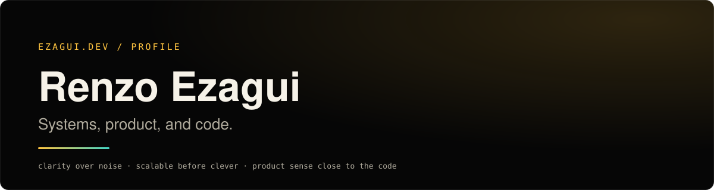

<picture>
  <source media="(prefers-color-scheme: dark)" srcset="assets/banner-dark.svg">
  <source media="(prefers-color-scheme: light)" srcset="assets/banner-light.svg">
  
</picture>

Designing useful products and solid systems, with a bias for clarity and quality.
Years in demanding environments shaped how I think about architecture, product decisions, and long-term maintainability. Personal projects are where that mindset stays close to the code.

[**ezagui.dev**](https://ezagui.dev) · [LinkedIn](https://linkedin.com/in/renzo-ezagui) · [renzo.ezagui@gmail.com](mailto:renzo.ezagui@gmail.com)

---

### `APPROACH`

```text
clarity over noise
scalable before clever
product sense close to the code
```

### `WHAT / HOW`

- Products, systems, and internal tooling built with long-term structure in mind.
- Architecture, solution design, and implementation kept practical and close to delivery.
- Creative, simple solutions that still respect scale, quality, and maintainability.

---

### `SELECTED WORK`

**Poker Planning** — [live](https://poker.ezagui.dev) · [frontend](https://github.com/renzo-ezagui/poker-planning-frontend) · [backend](https://github.com/renzo-ezagui/poker-planning-backend)
Realtime planning-poker rooms for agile teams, with a 3D table.
`NestJS` `Socket.IO` `MongoDB` `React` `React Three Fiber`

**Pokedex** — [live](https://pokedex.ezagui.dev) · [frontend](https://github.com/renzo-ezagui/pokedex-frontend) · [backend](https://github.com/renzo-ezagui/pokedex-backend)
Browsable Pokédex (809 Pokémon, Gen 1–7) over a small REST API.
`React` `Vite` `TypeScript`

**Birds** — [live](https://birds.ezagui.dev) · [source](https://github.com/renzo-ezagui/playground-birds)
Boid flocking simulation on canvas, built as a teaching tool for OOP and emergent behavior. No framework, no runtime dependencies.
`TypeScript` `Canvas 2D` `esbuild`

**AUX AC for Home Assistant** — [source](https://github.com/renzo-ezagui/homelab-ha-aux-lan)
Custom integration that controls AUX air conditioners over the local network, no cloud.
`Python` `Home Assistant`

---

### `STACK`

`TypeScript` `JavaScript` `Python` · `React` `Vite` `React Three Fiber` · `Node.js` `NestJS` `Socket.IO` · `MongoDB` `PostgreSQL` · `Docker` `Linux`
